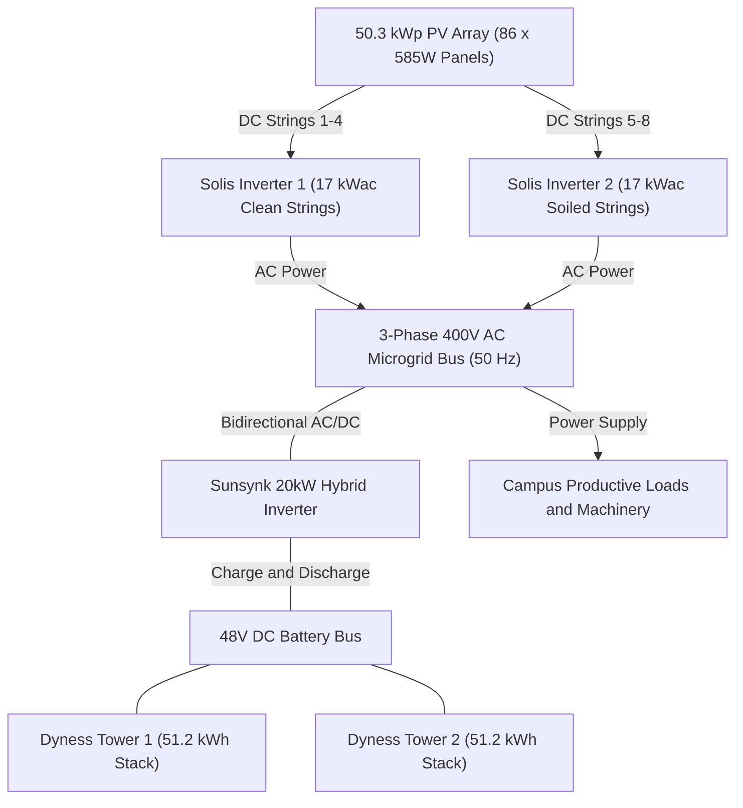
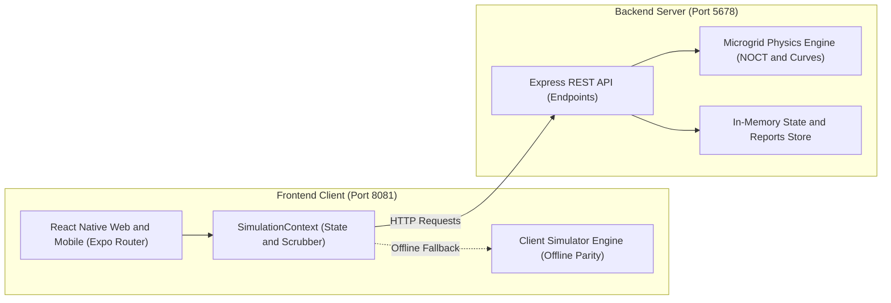

# CREDiT Digital Twin Platform

An interactive monitoring, dynamic physical simulation, predictive load allocation, and maintenance management platform designed for rural community solar microgrids in Sub-Saharan Africa.

---

## Table of Contents

1. [Executive Summary & Purpose](#executive-summary--purpose)
2. [Microgrid Physical Topology & Hardware Specifications](#microgrid-physical-topology--hardware-specifications)
3. [System Architecture & Technology Stack](#system-architecture--technology-stack)
4. [Physical Modeling & Dynamic Simulation Engine](#physical-modeling--dynamic-simulation-engine)
5. [User Interface & Application Modules](#user-interface--application-modules)
6. [Design System & UI/UX Principles](#design-system--uiux-principles)
7. [REST API Reference](#rest-api-reference)
8. [Getting Started & Local Development](#getting-started--local-development)
9. [Mobile Testing & Verification](#mobile-testing--verification)
10. [Repository Structure](#repository-structure)

---

## Executive Summary & Purpose

The **CREDiT Digital Twin Platform** bridges physical microgrid infrastructure with human-centric rural community operations. Built for off-grid and weak-grid environments in Sub-Saharan Africa, the platform provides local village operators and technicians with:

- **Real-Time Operational Telemetry**: Live monitoring of solar generation, battery energy storage, campus loads, and environmental factors.
- **Physics-Coupled Simulation Engine**: Dynamic modeling of solar irradiance, photovoltaic cell temperature heating (NOCT), inverter thermal dissipation, and battery charge/discharge thermodynamics.
- **Predictive Energy Allocation**: Intelligent scheduling of high-demand productive activities (water pumping, grain milling, commercial baking, workshop tools) aligned with peak solar windows.
- **Bilingual & Daylight-Readable Interface**: High-contrast, non-glare visual system tailored for mobile field devices and stationary control rooms with zero emoji dependencies and full i18n localization support.
- **Streamlined Maintenance & Fault Reporting**: Real-time inverter string health tracking, 15%–30% operational leeway variance detection, and mobile modal fault dispatch with photo upload capabilities.

---

## Microgrid Physical Topology & Hardware Specifications

The digital twin models a physical microgrid installation with the following hardware specifications:

```
                       [ 50.3 kWp PV Array ]
                 (86 x 585W Panels / Multi-String)
                                |
               +----------------+----------------+
               |                                 |
     [ Solis Inverter 1 ]              [ Solis Inverter 2 ]
    (17 kWac / Clean Strings)        (17 kWac / Dust Variance)
               |                                 |
               +----------------+----------------+
                                | (AC Bus)
                                |
                [ Sunsynk SUN-20K-SG05LP3-EU-SM2 ]
                    (20 kWac Battery Inverter)
                                |
            +-------------------+-------------------+
            | (48V DC Bus)                          |
   [ Tower 1: 10 x Dyness DL5.0C ]     [ Tower 2: 10 x Dyness DL5.0C ]
      (51.2 kWh / 51.2V Stack)            (51.2 kWh / 51.2V Stack)
            \                                       /
             +------------------+------------------+
                                |
                   Total Storage: 102.4 kWh
```



### Hardware Equipment Breakdown

| Component | Make & Model | Specifications | Role & Configuration |
| :--- | :--- | :--- | :--- |
| **Photovoltaic Array** | Tier-1 Monocrystalline | 50.3 kWp total capacity (86 x 585W modules) | Arranged across 8 multi-string combiner channels with voltage/current sensing. |
| **PV Inverters** | 2 x Solis S5-GR3P17K | 17 kWac continuous, 25.5 kWdc max each | 3-Phase 400V grid-tied inverters in parallel (34 kWac combined ceiling). Inverter 2 models road dust soiling and cooling fan variance. |
| **Storage Inverter** | 1 x Sunsynk SUN-20K-SG05LP3 | 20 kWac continuous bidirectional rating | Operates in `GRID_FORMING_ISLAND` mode, establishing microgrid voltage and frequency reference. |
| **Energy Storage (ESS)** | 2 x Dyness DL5.0C Pro Towers | 102.4 kWh gross capacity (2 x 51.2 kWh stacks) | 20 x 5.12 kWh LiFePO4 rack modules (51.2V, 100Ah each). 10% Depth-of-Discharge (DoD) protective reserve floor (10.24 kWh). |
| **Weather Telemetry** | Integrated Met Station | GHI Irradiance, Air Temp, Humidity, Wind, Barometer | Provides environmental inputs driving the NOCT cell heating and ambient cooling equations. |

---

## System Architecture & Technology Stack

The platform is architected as a lightweight monorepo with strict decoupling between UI visualization and backend physics simulation:

```
+-------------------------------------------------------------------------+
|                        CLIENT TIER (Port 8081)                          |
|   React Native for Web & Mobile (Expo Router, TypeScript)               |
|   - SimulationContext (Live Polling & 24h Time Scrubber)                |
|   - Client Simulation Engine (100% Offline Parity Fallback)             |
+-------------------------------------------------------------------------+
                                     |
                                HTTP / JSON
                                     |
+-------------------------------------------------------------------------+
|                        SERVER TIER (Port 5678)                          |
|   Node.js / Express REST API (/api/v1/*)                                |
|   - Coupled Microgrid Physics Engine (NOCT, Solis Curves, ESS Dynamics) |
|   - In-Memory Telemetry & Incident Reports Store                        |
+-------------------------------------------------------------------------+
```



### Technology Decisions

- **Frontend Client (`frontend/`)**: Built on React Native Web and Expo Router. Allows one unified codebase to serve modern desktop browsers, mobile touch devices, and native Android/iOS builds. Uses Feather icons and SVG charting with zero third-party graph dependencies for maximum bundle efficiency and predictable rendering.
- **Backend Service (`backend/`)**: Node.js and Express built in TypeScript. Operates an in-memory dynamic physical twin that updates with diurnal astronomical equations and organic stochastic micro-variations.
- **Offline Parity**: `frontend/services/api.ts` implements automated failover: if the backend server is unreachable, the frontend seamlessly transitions to client-side mathematical simulation (`frontend/services/simulator.ts`) without visual interruptions or crashes.

---

## Physical Modeling & Dynamic Simulation Engine

The backend simulation does not rely on static dummy numbers; it implements coupled physical models that realistically reflect solar PV and electrical engineering dynamics:

### 1. Diurnal Astronomical Solar Generation

Solar generation follows a diurnal sine curve bounded by dawn (06:00) and dusk (18:00):

$$P_{\text{ideal}}(t) = P_{\text{peak}} \cdot \sin\left(\frac{\pi (t - 6.0)}{12.0}\right) \quad \text{for } 6.0 \le t \le 18.0$$

where $P_{\text{peak}} = 50.3\text{ kW}$.

### 2. NOCT Cell Heating & Temperature Derating

Under strong direct sunlight, monocrystalline photovoltaic cells heat up significantly above ambient air temperature. The Nominal Operating Cell Temperature (NOCT) model calculates module cell temperature ($T_{\text{cell}}$) with convective wind cooling:

$$T_{\text{cell}} = T_{\text{amb}} + \frac{\text{NOCT} - 20}{800} \cdot G \cdot \left(1 - 0.03 \cdot \min(4, \max(0, v_{\text{wind}} - 1.0))\right)$$

where:
- $\text{NOCT} = 45^\circ\text{C}$
- $G$ is Global Horizontal Irradiance in $\text{W/m}^2$
- $v_{\text{wind}}$ is wind velocity in $\text{m/s}$

Monocrystalline silicon efficiency decreases by $-0.35\%/^\circ\text{C}$ above standard test conditions ($25^\circ\text{C}$):

$$\eta_{\text{temp}} = \max\left(0.75, 1.0 - 0.0035 \cdot (T_{\text{cell}} - 25.0)\right)$$

At midday solar noon with cell temperatures reaching $55^\circ\text{C}$ to $58^\circ\text{C}$, thermal derating reduces gross array output by **$10.5\%$ to $11.6\%$**.

### 3. Inverter Part-Load Efficiency & Thermal Dissipation

Real-world inverter efficiency varies with load ratio ($\chi = P_{\text{dc}} / P_{\text{rated}}$) and internal heatsink temperature:

$$\eta_{\text{inv}} = 0.984 - 0.07 \cdot (1.0 - \chi)^{2.5} - \Delta \eta_{\text{thermal}}$$

- **Inverter 1**: Connected to clean strings (strings 1–4, 98.5% optical cleanliness). Runs at baseline temperature ($T_{\text{amb}} + \Delta T_{\text{loss}}$).
- **Inverter 2**: Connected to strings 5–8 near the perimeter road, subject to dust accumulation (84.5% optical transmission factor) and degraded cooling fan airflow. The additional internal heat dissipation ($56^\circ\text{C}$) triggers thermal derating, producing the realistic **15%–30% operational leeway variance**.

### 4. Energy Storage System & Battery Thermal Coupling

The Dyness battery storage system tracks bidirectional energy flows with Sunsynk converter conversion efficiency ($\eta_{\text{charge}} = 96.5\%$, $\eta_{\text{discharge}} = 95.8\%$):

- **Cell Heating**: Tower internal temperature rises with ambient air transfer and internal $I^2 R$ Joule heating:

$$T_{\text{tower}} = T_{\text{room}} + 5.5^\circ\text{C} + 0.07 \cdot I_{\text{tower}}$$

- **Dual-Tower Balance**: Tower 1 draws $50.8\%$ and Tower 2 draws $49.2\%$ of total current, demonstrating active BMS cell balance across both 10-module stacks.
- **Runtime Projections**: System computes time to full charge during solar surplus (`Full Charge: 06:38 PM`) or depletion time to 10% protective reserve during nocturnal discharge (`Depletion: 01:33 AM`).

---

## User Interface & Application Modules

The user interface is organized into five specialized modules accessible via the bottom navigation bar on mobile or top navigation on desktop:

```
[ Dashboard ]  [ Forecast ]  [ Allocation ]  [ Battery ]  [ Maintenance ]
```

### 1. Dashboard (`/`)
- **System Health Status**: High-visibility status indicator (`OPTIMAL` or `WARNING`).
- **Live Power Balance Meter**: Visual split showing total solar generation (kW), total community load demand (kW), and net power balance.
- **Battery Storage Summary**: Aggregate SoC percentage, stored kWh, usable kWh above reserve, and active charging/discharging flow indicator.
- **Active Machinery Breakdown**: Real-time listing of active community machinery loads.
- **Weather Station Tile**: Ambient temperature, irradiance ($W/m^2$), humidity, and wind conditions.

### 2. Weather & Solar Forecast (`/forecast`)
- **Atmospheric Overview Card**: Live weather station hero card displaying temperature, feels-like temperature, UV index/level, barometric pressure, humidity, wind gusts, dew point, cloud cover, and solar zenith ephemeris.
- **24-Hour Chronological Hourly Weather Strip**: Horizontal scrollable hourly progression showing generation kW, irradiance, temperature, rain risk, and wind.
- **Single-Variable 24-Hour Parameter Curve**: SVG chart with segmented pill metric selector allowing operators to view **Solar Output**, **Irradiance**, **Temperature**, **Cloud Cover**, or **Wind Speed** strictly one variable at a time.
- **7-Day Meteorological Outlook**: Daily synoptic forecast linking expected solar yield (kWh) directly to rain probability, cloud cover, and natural rain array washing events.

### 3. Energy Allocation (`/allocation`)
- **Schedule Toggle**: Interactive switcher between **Standard Schedule** (baseline 235 kWh/day) and **Adjusted Schedule** (solar-optimized load shifting).
- **Gantt Timeline Chart**: Chronological visualization of productive machinery operating windows.
- **Responsive Layout**: Expansive tabular comparison on desktop screens; adaptive stacked activity cards on mobile screens.
- **Interactive Time Scrubber**: Slider allowing operators to simulate any hour of the day (00:00 to 24:00) with instantaneous telemetry updates.

### 4. Battery Diagnostics (`/battery`)
- **24-Hour Rolling Historical SoC Curve**: Visual timeline tracking storage depletion and replenishment over the past 24 hours.
- **Predictive Runtime Projection**: Dynamic badge and description indicating exact clock time for full charge or depletion to protective cutoff.
- **Dual Tower Comparison Cards**: Side-by-side telemetry for Tower 1 and Tower 2 (SoC, voltage, current, internal temperature, and BMS health).
- **Inverter Telemetry**: Sunsynk 20kW operating mode, AC power, and chassis temperature.

### 5. Maintenance & Fault Reporting (`/maintenance`)
- **Inverter Health & Leeway Tracking**: Live metrics for Solis Inverter 1 and Inverter 2 showing AC power, DC input, frequency, voltage, heatsink temperature, and percentage variance from benchmark.
- **Modal Fault Reporting Dialog**: Technicians can click "Submit Incident Report" to open a non-intrusive floating dialog. Supports equipment selection, fault classification, urgent severity calculation, and photo attachment.

---

## Design System & UI/UX Principles

| Principle | Specification | Rationale |
| :--- | :--- | :--- |
| **Strictly No Emojis** | Vector Feather icons (`@expo/vector-icons`) and clean SVGs only. | Ensures professional engineering presentation, cross-platform consistency, and clean visual hierarchy. |
| **Single-Variable Visualizations** | Each chart canvas renders strictly one physical variable. | Prevents misinterpretation caused by overlapping scales (e.g., kW vs. W/m² vs. °C). |
| **High Sunlight Contrast** | Minimum 4.5:1 text contrast ratio on solid backgrounds (`#F8F9FA` base, `#FFFFFF` surfaces). | Preserves readability in bright, direct outdoor sunlight conditions. |
| **Internationalization (i18n)** | All UI copy managed via structured translation dictionaries (`locales/en.json`). | Enables rapid translation into local languages (e.g., Swahili, French) without modifying JSX components. |
| **Mobile-First Responsive** | Breakpoints at 768px and 1024px. Expansive desktop tables gracefully fold into card stacks on mobile viewports. | Accommodates mobile field phones (360px–480px) and stationary office monitors. |

---

## REST API Reference

The backend exposes RESTful endpoints under `/api/v1/microgrid`:

### `GET /api/v1/microgrid/overview?hour={hour}`
Returns current microgrid power balance, battery status, and weather summary.
- **Query Params**: `hour` (optional, float `0.0`–`24.0`).
- **Response**: `OverviewTelemetry` JSON object.

### `GET /api/v1/microgrid/forecast/24h?hour={hour}`
Returns 24-hour single-variable curve data, 24-hour chronological hourly weather, and 7-day outlook.
- **Query Params**: `hour` (optional, float `0.0`–`24.0`).
- **Response**: `ForecastResponse` JSON object with `weatherOverview`, `hourlyWeather`, and `sevenDayOutlook`.

### `GET /api/v1/microgrid/allocations?view={planned|adjusted}&hour={hour}`
Returns scheduled community load items for the specified view mode.
- **Query Params**: `view` (`planned` or `adjusted`), `hour` (float `0.0`–`24.0`).
- **Response**: `AllocationResponse` JSON object.

### `GET /api/v1/microgrid/battery/diagnostics?hour={hour}`
Returns dual-tower telemetry, Sunsynk inverter health, and 24h rolling historical SoC points.
- **Query Params**: `hour` (optional, float `0.0`–`24.0`).
- **Response**: `BatteryDiagnosticsResponse` JSON object.

### `GET /api/v1/microgrid/maintenance/inverters?hour={hour}`
Returns status, heatsink temperature, and variance percentages for Solis inverters.
- **Query Params**: `hour` (optional, float `0.0`–`24.0`).
- **Response**: Array of `InverterTelemetry` objects.

### `POST /api/v1/microgrid/maintenance/report`
Submits a technician incident report with optional equipment photo.
- **Content-Type**: `multipart/form-data` or `application/json`.
- **Payload**: `technicianName`, `incidentTimestamp`, `equipmentIds`, `faultTypes`, `photo` (file).
- **Response**: `MaintenanceReportResponse` with assigned `reportId` and calculated urgency level (`LOW`, `MEDIUM`, `HIGH`).

### `GET /health`
Returns system status (`{ "status": "healthy", "service": "credit-digital-twin-backend" }`).

---

## Getting Started & Local Development

### Prerequisites
- Node.js 20+ installed
- npm 10+ installed
- Modern web browser (Chrome, Edge, Firefox, Safari)

### 1. Clone & Install Dependencies

```bash
git clone https://github.com/your-org/credit-digital-twin.git
cd credit-digital-twin

# Install backend dependencies
cd backend
npm install

# Install frontend dependencies
cd ../frontend
npm install
```

### 2. Start the Backend Server

```bash
cd backend
npm run dev
```
The backend server will start at `http://localhost:5678`. Verify by running:
```bash
curl http://localhost:5678/health
```

### 3. Start the Frontend Development Server

In a separate terminal:
```bash
cd frontend
npx expo start --web --port 8081
```
Open your browser at `http://localhost:8081` to view the application.

---

## Mobile Testing & Verification

1. **Browser Mobile Emulation**:
   - Open Developer Tools in Chrome or Edge (`F12` or `Ctrl + Shift + I`).
   - Toggle Device Toolbar (`Ctrl + Shift + M`).
   - Select mobile devices (e.g., iPhone 14, Samsung Galaxy S20, Pixel 7).
   - Test responsive behaviors:
     - Navigation tab bar pins to the bottom of the screen.
     - Allocation items collapse into mobile stacked cards.
     - Maintenance report opens as a modal sheet with touch-friendly checkboxes and photo upload.
2. **Local Network Testing (Physical Phone)**:
   - Ensure your phone and development computer are connected to the same Wi-Fi network.
   - Run `npx expo start` in `frontend/`.
   - Scan the QR code using the **Expo Go** app on Android or the Camera app on iOS.

---

## Repository Structure

```
CREDiT-Visual-Demo/
├── frontend/                         # React Native (Expo Router) Client
│   ├── app/                          # File-based navigation routes
│   │   ├── (tabs)/                   # Tab navigation screens
│   │   │   ├── _layout.tsx           # Responsive tab bar & desktop top-bar
│   │   │   ├── index.tsx             # Overview Dashboard
│   │   │   ├── forecast.tsx          # Weather & Solar Forecast
│   │   │   ├── allocation.tsx        # Productive Energy Allocation
│   │   │   ├── battery.tsx           # Battery Storage & Diagnostics
│   │   │   └── maintenance.tsx       # Inverter Health & Incident Reporting
│   │   └── _layout.tsx               # Root app layout & Simulation Provider
│   ├── components/                   # Reusable UI component library
│   │   ├── AllocationTimelineChart.tsx # Gantt timeline and schedule view
│   │   ├── BatteryHistoryChart.tsx   # 24h battery historical SVG chart
│   │   ├── HourlyWeatherStrip.tsx    # 24-hour chronological weather strip
│   │   ├── MaintenanceModal.tsx      # Modal incident reporting window
│   │   ├── PowerBalanceMeter.tsx     # Visual generation/load split meter
│   │   ├── SevenDayOutlook.tsx       # 7-day meteorological forecast cards
│   │   ├── SimulationTimeScrubber.tsx# Interactive 24-hour time slider
│   │   ├── SolarForecastChart.tsx    # Single-variable solar parameter curve
│   │   └── WeatherOverviewCard.tsx   # Hero weather station card
│   ├── constants/                    # Design tokens (Colors, Typography)
│   ├── locales/                      # Internationalization catalogs (en.json)
│   ├── services/                     # State management, API, and fallback engine
│   │   ├── SimulationContext.tsx     # Reactive state provider
│   │   ├── api.ts                    # Backend API client with auto-fallback
│   │   ├── simulator.ts              # Client-side physical simulation engine
│   │   └── i18n.ts                   # Localization helper
│   ├── types/                        # TypeScript definitions
│   └── package.json
├── backend/                          # Node.js / Express Simulation Server
│   ├── src/
│   │   ├── controllers/              # REST endpoint handlers
│   │   ├── routes/                   # Express router definitions
│   │   ├── services/                 # Physics models (NOCT, Inverters, ESS)
│   │   │   └── simulation.service.ts # Core dynamic simulation engine
│   │   ├── types/                    # Shared telemetry types
│   │   └── index.ts                  # Server entry point & CORS configuration
│   ├── uploads/                      # Uploaded incident maintenance photos
│   ├── tsconfig.json
│   └── package.json
├── design_spec.txt                   # Detailed hardware and engineering specifications
└── README.md                         # Project documentation
```
